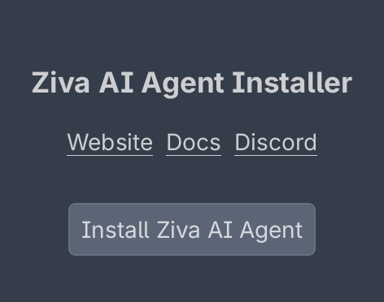

# Ziva Installer for the Godot Asset Library

This is the source of the "Ziva Installer" editor plugin, the Ziva entry on the Godot Asset Library (asset 4879, https://godotengine.org/asset-library/asset/4879). It adds a dock to the Godot editor that downloads Ziva into your project's `addons/ziva_agent` folder. Ziva is an AI agent that runs inside the Godot editor, made by Zivash Inc. (https://ziva.sh).

## Use it

1. Open your project in Godot 4.2 or later.
2. Click the AssetLib tab.
3. Search for `Ziva Installer`.
4. Click it, then click `Download`.
5. The installer dock appears on the left side. Click `Install Ziva AI Agent`.
6. When it says the installation is complete, restart the editor.

The dock downloads the latest Ziva plugin zip for your platform from https://github.com/ziva-sh/ziva-agent-plugin-godot/releases. If `res://addons/ziva_agent` already exists, the dock does not appear.

To uninstall, close Godot, delete the `addons/ziva_agent` and `addons/ziva_installer` folders, and reopen the project.

Other ways to install Ziva (the Ziva installer app or the manual zip): https://ziva.sh/docs/installation

## What it installs

Ziva works in the Godot editor. It reads your project files, inspects the scene tree, checks editor errors, edits scenes and scripts, runs the game to check its work and fixes the errors it finds.

- Requirements: Godot 4.2 or later; Windows, macOS 13 or newer, or Linux; an internet connection for AI features.
- Plans: Hobby is free, Basic is $20/month, Pro is $50/month and Ultra is $200/month. Parallel mode and the Playtest Agent are on Pro and Ultra, in Godot only; Parallel mode uses much more plan usage than a normal chat. Details: https://ziva.sh/pricing
- Use your own Claude Pro/Max or ChatGPT Plus/Pro subscription inside Godot: sign in from Ziva's settings, no API key needed, on every plan including free Hobby (https://ziva.sh/docs/existing-subscriptions).
- Full feature list: https://github.com/ziva-sh/ziva-agent-plugin-godot#readme
- Documentation: https://ziva.sh/docs

## License

This installer is released under the MIT License (LICENSE.md). That license covers only the installer in this repository. Ziva itself, which the installer downloads, is proprietary software of Zivash, Inc. and is not open source; use is governed by the terms of service at https://ziva.sh/terms.

## Support

- Bug reports: https://github.com/ziva-sh/ziva-agent-plugin-godot/issues
- Discord: https://ziva.sh/discord
