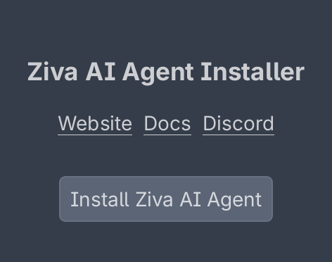

# Ziva.sh Installer for Godot

Ziva.sh is an AI assistant built into the Godot editor. It creates and edits scenes, nodes, and scripts; reads editor errors and output, runs tests, and fixes failures; and playtests games with real keyboard and mouse input.

Download the installer for your platform at https://ziva.sh/download.

### Installation

1. Open Godot

2. Click on the AssetLib tab

3. Search for `Ziva Installer`

4. Click it and click `Download`

5. You should see the installer Dock on the left side

6. Click on `Install Ziva AI Agent`

Note: If Ziva AI Agent is already installed (res://addons/ziva_agent) the installer dock will not appear.

For any help join the discord server: [Ziva Discord](https://ziva.sh/discord)